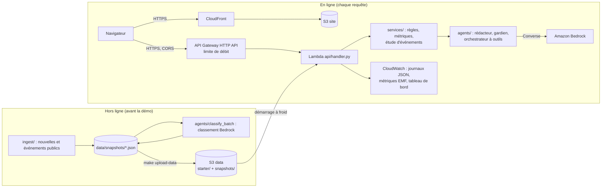

# Architecture

AlphaForge AI est une simulation éducative, pas un conseil financier. Le code calcule les chiffres et
applique les règles; le modèle de langage (Bedrock) classe des titres et rédige à partir de preuves.



## Flux

**Hors ligne.** `make ingest` récupère titres et événements (sources publiques, date et lien conservés),
`make classify` les classe avec Bedrock (sortie JSON validée par schéma, titres traités comme des données
non fiables), puis `make upload-data` envoie le jeu de départ et les snapshots sur S3. Rien de lent ne reste
sur le chemin en ligne.

**En ligne.** Le site React (S3 + CloudFront) appelle l'API. API Gateway transmet à la Lambda, qui:

1. au démarrage à froid seulement, copie `starter/` et `snapshots/` de S3 vers `/tmp/data` (`api/bootstrap.py`);
2. valide le corps de la requête contre `contracts/alphaforge.schema.json` (`api/routes.py`);
3. appelle la façade `services` (rôle A): profil par règles, portefeuille, fil trié, cohérence;
4. pour « J'envisage d'acheter X », l'orchestrateur laisse le modèle choisir ses outils (`check_coherence`,
   `get_position_metrics`, ...); le verdict vient toujours des règles;
5. renvoie le JSON du contrat et écrit une ligne de journal (route, statut, durée, noms des outils).

Si Bedrock est indisponible, le fil se dégrade proprement (règles et preuves, sans résumé): jamais
d'explication inventée.

## Sécurité et vie privée

- Buckets privés, chiffrés (SSE-S3), accès public bloqué; le site n'est lisible que par CloudFront (OAC).
- Rôle Lambda au moindre privilège: un seul modèle Bedrock, lecture des seuls préfixes de données.
- Aucun portefeuille, CSV, profil ou titre dans les journaux (test `test_lambda_handler_roundtrip_and_logs_have_no_portfolio`).
  Les erreurs inattendues ne journalisent que le type et la pile (fichier, ligne), jamais le message.
- Aucun stockage de portefeuille: tout reste en mémoire pendant la requête.
- Aucune clé dans le dépôt: identifiants par variables d'environnement ou SSO (`.env` est ignoré par Git).
- Corps limité à 512 Ko; débit limité à 10 requêtes/s.

## Local ou AWS: même contrat

`api/local_server.py` (FastAPI, `make dev`) et `api/handler.py` (Lambda) passent tous les deux par
`api.routes.dispatch`: les routes, la validation et le format d'erreur sont identiques.

| | Local (`make dev`) | AWS |
| --- | --- | --- |
| `LLM_PROVIDER` | `mock` | `bedrock` |
| Données | `DATA_DIR=data` | S3 `DATA_BUCKET` -> `/tmp/data` |
| CORS | `localhost:5173` | URL CloudFront et `localhost:5173` |

## Reproduire dans un autre compte

Prérequis: AWS CLI v2, Python 3.11+, Node 22, identifiants AWS dans l'environnement, accès Bedrock au
modèle choisi.

```bash
python infra/scripts/check_bedrock.py --model us.anthropic.claude-haiku-4-5-20251001-v1:0
export BEDROCK_MODEL_ID=us.anthropic.claude-haiku-4-5-20251001-v1:0 AWS_REGION=us-east-1
python scripts/deploy.py deploy        # pile, Lambda, API, buckets, CloudFront, données
python scripts/deploy.py deploy-web    # site
python scripts/smoke_test.py --deployed
python scripts/deploy.py destroy       # à la fin, après confirmation
```

Coûts: voir `docs/AWS.md`.
